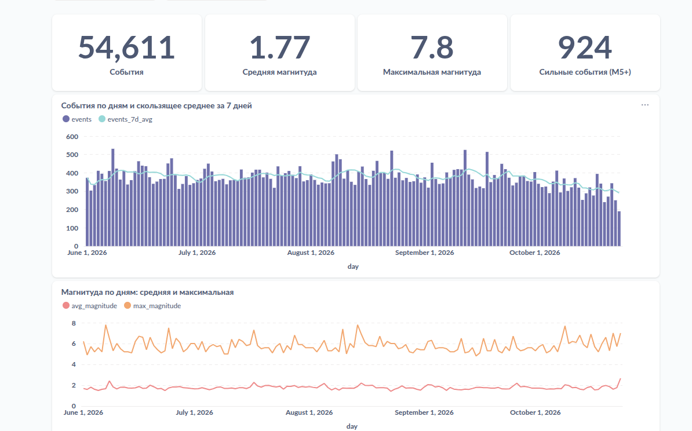
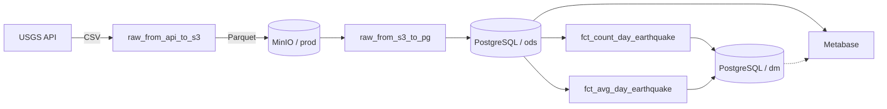
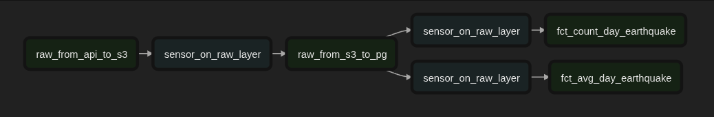

# Earthquake Data Pipeline

Локальный ETL-пайплайн для ежедневной загрузки данных о землетрясениях из
[USGS Earthquake Catalog](https://earthquake.usgs.gov/fdsnws/event/1/), хранения
сырых данных в MinIO и расчёта витрин в PostgreSQL под управлением Apache
Airflow.

Проект предназначен для локальной разработки и демонстрации полного пути
данных: API → объектное хранилище → ODS → аналитические витрины → BI.

## Результат

В Metabase данные представлены в виде дашборда «Землетрясения: обзор»: KPI,
динамика числа событий и магнитуды по дням, распределения по магнитуде и
глубине, рейтинг регионов мира и карты событий (создаётся скриптом, см.
[Дашборд в Metabase](#дашборд-в-metabase)):



## Архитектура



DuckDB используется внутри Python-задач Airflow для чтения CSV/Parquet и
передачи данных между USGS, MinIO и PostgreSQL.

Граф зависимостей DAG:



### Слои данных

| Слой | Объект | Назначение |
|---|---|---|
| RAW | `s3://prod/raw/earthquake/<date>/...parquet` | Снимок ответа USGS за один день |
| ODS | `ods.fct_earthquake` | Детальные события без агрегации |
| DM | `dm.fct_count_day_earthquake` | Количество событий по дням |
| DM | `dm.fct_avg_day_earthquake` | Средняя магнитуда по дням |
| STG | `stg.tmp_*` | Временные таблицы для пересчёта одного дня |

## DAG-и

Все DAG-и запускаются ежедневно в `05:00` по часовому поясу
`Europe/Moscow`. Начальная дата и `catchup` задаются непосредственно в файлах
DAG.

| DAG | Зависимость | Результат |
|---|---|---|
| `raw_from_api_to_s3` | — | Запрашивает CSV из USGS и сохраняет Parquet в MinIO |
| `raw_from_s3_to_pg` | `raw_from_api_to_s3` | Загружает Parquet в `ods.fct_earthquake` |
| `fct_count_day_earthquake` | `raw_from_s3_to_pg` | Заполняет витрину количества событий |
| `fct_avg_day_earthquake` | `raw_from_s3_to_pg` | Заполняет витрину средней магнитуды |

Зависимые DAG-и используют `ExternalTaskSensor` и ожидают успешный upstream-run
с той же logical date. Поэтому расписание, часовой пояс и `start_date` у всей
цепочки должны оставаться согласованными.

## Требования

- Docker Engine;
- Docker Compose v2;
- не менее 4 ГБ RAM и 2 CPU;
- свободные порты `5432`, `8080`, `9000`, `9001` и `3000`;
- доступ в интернет к `earthquake.usgs.gov`.

Локальная установка Python не требуется: Airflow и DuckDB запускаются в
контейнерах.

## Быстрый старт

### 1. Подготовить переменные окружения

```bash
cp .env.example .env
```

Для Linux укажите UID текущего пользователя:

```bash
printf 'AIRFLOW_UID=%s\n' "$(id -u)" > .env
```

### 2. Инициализировать Airflow и запустить сервисы

```bash
docker compose up airflow-init
docker compose up -d
docker compose ps
```

После запуска доступны:

| Сервис | Адрес | Логин по умолчанию |
|---|---|---|
| Airflow | <http://localhost:8080> | `airflow / airflow` |
| MinIO Console | <http://localhost:9001> | `minioadmin / minioadmin` |
| Metabase | <http://localhost:3000> | создаётся при первом входе |
| PostgreSQL DWH | `localhost:5432` | `postgres / postgres` |

Учётные данные из `docker-compose.yaml` подходят только для локальной
разработки.

### 3. Создать bucket в MinIO

Откройте MinIO Console и создайте bucket с именем `prod`. DAG-и записывают
объекты по пути:

```text
s3://prod/raw/earthquake/YYYY-MM-DD/YYYY-MM-DD_00-00-00.gz.parquet
```

### 4. Создать схемы и таблицы DWH

```bash
docker compose exec -T postgres_dwh psql -U postgres -d postgres < sql/init_dwh.sql
```

Для инициализации витрин не используйте `CREATE TABLE AS SELECT`: он создаёт
одноразовый снимок и не обновляется при появлении новых строк в ODS.

### 5. Настроить Airflow

```bash
AF="docker compose exec -T airflow-scheduler airflow"
$AF variables set access_key minioadmin
$AF variables set secret_key minioadmin
$AF variables set pg_password postgres
$AF connections add postgres_dwh --conn-type postgres --conn-host postgres_dwh \
  --conn-login postgres --conn-password postgres --conn-schema postgres --conn-port 5432
$AF dags list-import-errors
```

### 6. Запустить пайплайн

При первом запуске включайте DAG-и в порядке движения данных:

```bash
docker compose exec -T airflow-scheduler airflow dags unpause raw_from_api_to_s3
docker compose exec -T airflow-scheduler airflow dags unpause raw_from_s3_to_pg
docker compose exec -T airflow-scheduler airflow dags unpause fct_count_day_earthquake
docker compose exec -T airflow-scheduler airflow dags unpause fct_avg_day_earthquake
```

При `catchup=True` Airflow создаст дневные запуски от `start_date` до текущей
даты. В проекте установлен `max_active_runs=1`, поэтому исторические интервалы
обрабатываются последовательно и первичная загрузка может занять несколько
минут.

## Дашборд в Metabase

Скрипт `metabase/provision_dashboard.py` создаёт подключение к DWH, коллекцию
«Землетрясения» и дашборд «Землетрясения: обзор». Карточки читают
`ods.fct_earthquake` (только `type = 'earthquake'`):

- KPI: число событий, средняя и максимальная магнитуда, число событий M5+;
- события по дням со скользящим средним за 7 дней;
- средняя и максимальная магнитуда по дням;
- распределение по магнитуде и по глубине очагов;
- топ-10 регионов и таблица самых сильных землетрясений;
- карта событий M3+;
- фильтры «С даты» и «По дату» для всего дашборда.

Запуск (нужен только Python 3, зависимости не требуются):

```bash
MB_EMAIL=admin@example.com MB_PASSWORD='change-me-please' \
  python3 metabase/provision_dashboard.py
```

Если Metabase ещё не настроен, скрипт создаст администратора с этими
учётными данными. Повторный запуск обновляет существующие карточки и дашборд.
Адрес Metabase и параметры DWH переопределяются переменными `MB_URL`,
`DWH_HOST`, `DWH_PORT`, `DWH_DB`, `DWH_USER`, `DWH_PASSWORD`.

## Эксплуатация

Проверка результата, перезапуск и backfill, диагностика и хранение данных
описаны в [docs/operations.md](docs/operations.md).

## Структура проекта

```text
.
├── dags/
│   ├── raw_from_api_to_s3.py
│   ├── raw_from_s3_to_pg.py
│   ├── fct_count_day_earthquake.py
│   └── fct_avg_day_earthquake.py
├── data/                  # локальные данные MinIO
├── docs/                  # эксплуатация и скриншоты
├── metabase/              # образ Metabase и скрипт дашборда
├── sql/                   # DDL для DWH
├── docker-compose.yaml
├── requirements.txt
└── README.md
```

## Лицензия

Проект распространяется по лицензии [MIT](LICENSE).
