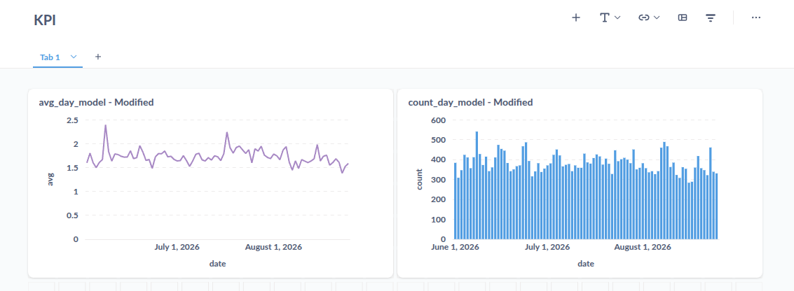
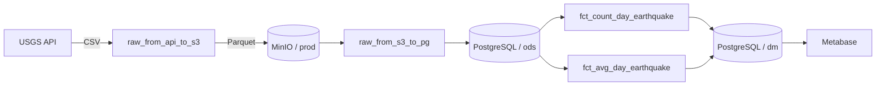

# Earthquake Data Pipeline

Локальный ETL-пайплайн для ежедневной загрузки данных о землетрясениях из
[USGS Earthquake Catalog](https://earthquake.usgs.gov/fdsnws/event/1/), хранения
сырых данных в MinIO и расчёта витрин в PostgreSQL под управлением Apache
Airflow.

Проект предназначен для локальной разработки и демонстрации полного пути
данных: API → объектное хранилище → ODS → аналитические витрины → BI.

## Результат

В Metabase данные представлены в виде KPI-дашборда с динамикой средней
магнитуды и количества землетрясений по дням:



## Архитектура



DuckDB используется внутри Python-задач Airflow для чтения CSV/Parquet и
передачи данных между USGS, MinIO и PostgreSQL.

Граф зависимостей DAG:


### Слои данных

| Слой | Объект | Назначение |
|---|---|---|
| RAW | `s3://prod/raw/earthquake/<date>/...parquet` | Снимок ответа USGS за один день |
| ODS | `ods.fct_earthquake` | Детальные события без агрегации |
| DM | `dm.fct_count_day_earthquake` | Количество событий по дням |
| DM | `dm.fct_avg_day_earthquake` | Средняя магнитуда по дням |
| STG | `stg.tmp_*` | Временные таблицы для пересчёта одного дня |

## DAG-и

Все DAG-и запускаются ежедневно в `05:00` по часовому поясу
`Europe/Moscow`. Начальная дата и `catchup` задаются непосредственно в файлах
DAG.

| DAG | Зависимость | Результат |
|---|---|---|
| `raw_from_api_to_s3` | — | Запрашивает CSV из USGS и сохраняет Parquet в MinIO |
| `raw_from_s3_to_pg` | `raw_from_api_to_s3` | Загружает Parquet в `ods.fct_earthquake` |
| `fct_count_day_earthquake` | `raw_from_s3_to_pg` | Заполняет витрину количества событий |
| `fct_avg_day_earthquake` | `raw_from_s3_to_pg` | Заполняет витрину средней магнитуды |

Зависимые DAG-и используют `ExternalTaskSensor` и ожидают успешный upstream-run
с той же logical date. Поэтому расписание, часовой пояс и `start_date` у всей
цепочки должны оставаться согласованными.

## Требования

- Docker Engine;
- Docker Compose v2;
- не менее 4 ГБ RAM и 2 CPU;
- свободные порты `5432`, `8080`, `9000`, `9001` и `3000`;
- доступ в интернет к `earthquake.usgs.gov`.

Локальная установка Python не требуется: Airflow и DuckDB запускаются в
контейнерах.

## Быстрый старт

### 1. Подготовить переменные окружения

```bash
cp .env.example .env
```

Для Linux укажите UID текущего пользователя:

```bash
printf 'AIRFLOW_UID=%s\n' "$(id -u)" > .env
```

### 2. Инициализировать Airflow и запустить сервисы

```bash
docker compose up airflow-init
docker compose up -d
docker compose ps
```

После запуска доступны:

| Сервис | Адрес | Логин по умолчанию |
|---|---|---|
| Airflow | <http://localhost:8080> | `airflow / airflow` |
| MinIO Console | <http://localhost:9001> | `minioadmin / minioadmin` |
| Metabase | <http://localhost:3000> | создаётся при первом входе |
| PostgreSQL DWH | `localhost:5432` | `postgres / postgres` |

Учётные данные из `docker-compose.yaml` подходят только для локальной
разработки.

### 3. Создать bucket в MinIO

Откройте MinIO Console и создайте bucket с именем `prod`. DAG-и записывают
объекты по пути:

```text
s3://prod/raw/earthquake/YYYY-MM-DD/YYYY-MM-DD_00-00-00.gz.parquet
```

### 4. Создать схемы и таблицы DWH

```bash
docker compose exec -T postgres_dwh psql -U postgres -d postgres <<'SQL'
CREATE SCHEMA IF NOT EXISTS stg;
CREATE SCHEMA IF NOT EXISTS ods;
CREATE SCHEMA IF NOT EXISTS dm;

CREATE TABLE IF NOT EXISTS ods.fct_earthquake (
    time             varchar,
    latitude         varchar,
    longitude        varchar,
    depth            varchar,
    mag              varchar,
    mag_type         varchar,
    nst              varchar,
    gap              varchar,
    dmin             varchar,
    rms              varchar,
    net              varchar,
    id               varchar,
    updated          varchar,
    place            varchar,
    type             varchar,
    horizontal_error varchar,
    depth_error      varchar,
    mag_error        varchar,
    mag_nst          varchar,
    status           varchar,
    location_source  varchar,
    mag_source       varchar
);

CREATE TABLE IF NOT EXISTS dm.fct_count_day_earthquake (
    date  date,
    count bigint
);

CREATE TABLE IF NOT EXISTS dm.fct_avg_day_earthquake (
    date date,
    avg  double precision
);
SQL
```

`CREATE TABLE AS SELECT` для инициализации витрины использовать не нужно: эта
команда создаёт одноразовый снимок и не обновляет таблицу при появлении новых
строк в ODS.

### 5. Настроить Airflow

DAG-и ожидают три Airflow Variable:

```bash
docker compose exec -T airflow-scheduler \
  airflow variables set access_key minioadmin

docker compose exec -T airflow-scheduler \
  airflow variables set secret_key minioadmin

docker compose exec -T airflow-scheduler \
  airflow variables set pg_password postgres
```

Добавьте подключение к DWH:

```bash
docker compose exec -T airflow-scheduler \
  airflow connections add postgres_dwh \
  --conn-type postgres \
  --conn-host postgres_dwh \
  --conn-login postgres \
  --conn-password postgres \
  --conn-schema postgres \
  --conn-port 5432
```

Проверить настройки:

```bash
docker compose exec -T airflow-scheduler airflow variables list
docker compose exec -T airflow-scheduler airflow connections get postgres_dwh
docker compose exec -T airflow-scheduler airflow dags list-import-errors
```

### 6. Запустить пайплайн

При первом запуске включайте DAG-и в порядке движения данных:

```bash
docker compose exec -T airflow-scheduler airflow dags unpause raw_from_api_to_s3
docker compose exec -T airflow-scheduler airflow dags unpause raw_from_s3_to_pg
docker compose exec -T airflow-scheduler airflow dags unpause fct_count_day_earthquake
docker compose exec -T airflow-scheduler airflow dags unpause fct_avg_day_earthquake
```

При `catchup=True` Airflow создаст дневные запуски от `start_date` до текущей
даты. В проекте установлен `max_active_runs=1`, поэтому исторические интервалы
обрабатываются последовательно и первичная загрузка может занять несколько
минут.

## Проверка результата

Количество строк и доступный диапазон ODS:

```bash
docker compose exec -T postgres_dwh psql -U postgres -d postgres -c \
  "SELECT count(*) AS rows,
          count(DISTINCT time::date) AS days,
          min(time::date) AS min_date,
          max(time::date) AS max_date
     FROM ods.fct_earthquake;"
```

Содержимое витрины:

```bash
docker compose exec -T postgres_dwh psql -U postgres -d postgres -c \
  "SELECT date, count
     FROM dm.fct_count_day_earthquake
    ORDER BY date DESC
    LIMIT 10;"
```

Сверка витрины с ODS:

```sql
SELECT
    ods.date,
    ods.event_count AS ods_count,
    dm.count AS dm_count
FROM (
    SELECT time::date AS date, count(*) AS event_count
    FROM ods.fct_earthquake
    GROUP BY 1
) AS ods
FULL JOIN dm.fct_count_day_earthquake AS dm USING (date)
WHERE ods.event_count IS DISTINCT FROM dm.count
ORDER BY date;
```

Пустой результат означает, что витрина совпадает с источником.

## Перезапуск и backfill

### В ODS данные есть, нужно пересчитать только DM

Очистите task instances нужного DAG за выбранный диапазон. Airflow выполнит их
повторно:

```bash
docker compose exec -T airflow-scheduler \
  airflow tasks clear fct_count_day_earthquake \
  --start-date 2026-06-01 \
  --end-date 2026-06-10 \
  --yes
```

Для витрины средней магнитуды замените DAG ID на
`fct_avg_day_earthquake`.

### В ODS отсутствуют даты, но файлы есть в MinIO

Сначала повторно загрузите только отсутствующий диапазон:

```bash
docker compose exec -T airflow-scheduler \
  airflow tasks clear raw_from_s3_to_pg \
  --task-regex '^get_and_transfer_raw_data_to_ods_pg$' \
  --start-date 2026-06-01 \
  --end-date 2026-06-10 \
  --yes
```

После успешного заполнения ODS очистите соответствующие DM runs командой из
предыдущего раздела.

> Важно: текущая ODS-загрузка использует обычный `INSERT`, а не upsert.
> Повторный запуск уже загруженной даты создаст дубликаты и завысит агрегаты.
> Перед очисткой task instances сначала определите действительно отсутствующие
> даты.

Найти пропуски в диапазоне:

```sql
WITH expected AS (
    SELECT generate_series(
        DATE '2026-06-01',
        DATE '2026-08-25',
        INTERVAL '1 day'
    )::date AS date
),
loaded AS (
    SELECT DISTINCT time::date AS date
    FROM ods.fct_earthquake
)
SELECT expected.date
FROM expected
LEFT JOIN loaded USING (date)
WHERE loaded.date IS NULL
ORDER BY expected.date;
```

## Диагностика

### DAG зелёный, но DM-таблица пустая

Успешный SQL без выбранных строк остаётся успешной задачей. Сначала сравните
logical date запуска с датами в ODS:

```sql
SELECT time::date AS date, count(*)
FROM ods.fct_earthquake
GROUP BY 1
ORDER BY 1;
```

В логе задачи `create_stg_table` строка `Rows affected: 0` означает, что для
этой logical date исходных данных не было. Нужно восстановить ODS за эту дату,
а затем перезапустить DM DAG.

### Сенсор ждёт upstream DAG

Проверьте, что оба DAG имеют run с одинаковой logical date:

```bash
docker compose exec -T airflow-scheduler \
  airflow dags list-runs -d raw_from_s3_to_pg

docker compose exec -T airflow-scheduler \
  airflow dags list-runs -d fct_count_day_earthquake
```

### Ошибка импорта DAG

```bash
docker compose exec -T airflow-scheduler airflow dags list-import-errors
docker compose logs --tail=200 airflow-scheduler
```

### Состояние контейнеров

```bash
docker compose ps
docker compose logs --tail=200 airflow-worker
```

## Хранение данных

MinIO сохраняет данные в каталоге `./data`, а метаданные Airflow — в именованном
volume `postgres-db-volume`.

В текущем `docker-compose.yaml` у `postgres_dwh` не задан именованный volume.
Перед длительным использованием рекомендуется добавить:

```yaml
services:
  postgres_dwh:
    volumes:
      - postgres-dwh-volume:/var/lib/postgresql/data

volumes:
  postgres-db-volume:
  postgres-dwh-volume:
```

Без этого после пересоздания контейнера Airflow может помнить старые успешные
запуски, хотя таблицы DWH уже потеряны. Именно в такой ситуации downstream DAG
может завершаться успешно с `0 rows affected`.

Остановить сервисы без явного удаления именованных volumes:

```bash
docker compose down
```

Не используйте `docker compose down -v`, если данные нужно сохранить.

## Структура проекта

```text
.
├── dags/
│   ├── raw_from_api_to_s3.py
│   ├── raw_from_s3_to_pg.py
│   ├── fct_count_day_earthquake.py
│   └── fct_avg_day_earthquake.py
├── data/                  # локальные данные MinIO
├── metabase/
├── docker-compose.yaml
├── requirements.txt
└── README.md
```

## Лицензия

Проект распространяется по лицензии [MIT](LICENSE).
